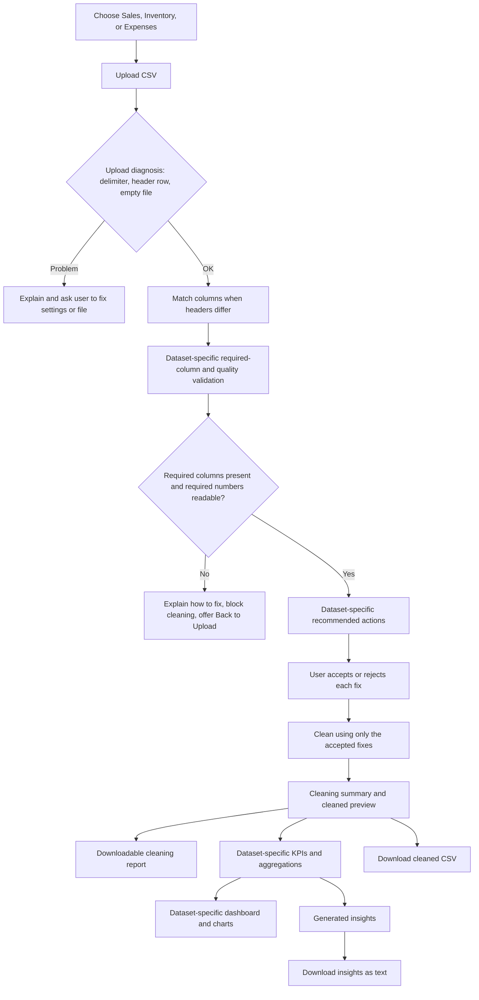

# Architecture and Workflow

## Overview

The application is a single-process Streamlit prototype. The front end accepts
a CSV upload and guides the user through validation, cleaning, dashboard
analysis, and generated insights. pandas DataFrames carry the uploaded and
cleaned data between steps in Streamlit session state. The application has no
database, external API, or persistent upload store.

## Main components

| Component | Responsibility |
| --- | --- |
| `frontend/streamlit_app_v2.py` | Streamlit layout, staged navigation, upload, session state, validation/cleaning orchestration, dashboard, and insight display. |
| `frontend/streamlit_app.py` | Original single-page Streamlit prototype retained as an alternate entry point. |
| `frontend/charts.py` | Altair charts with explicit chronological labels and date tooltips, rendered in Streamlit. |
| `frontend/inventory_pages.py` | The Inventory upload, check, dashboard, and insights pages, plus the shared dataset-type selector. |
| `frontend/expenses_pages.py` | Expenses upload, check, dashboard, and insights pages; reuses the shared dataset selector and workflow state. |
| `backend/load_csv.py` | Low-level CSV parsing for a path or file-like input. Selects delimiter and header behavior without imposing a dataset schema. |
| `backend/csv_loader.py` | Dataset-specific layer over `load_csv.py` (Sales, Inventory, and Expenses); assigns required names for headerless files, rejects incompatible layouts, and turns empty/unreadable/ragged files into friendly errors. |
| `backend/upload_diagnosis.py` | Detects likely upload-setting mistakes (wrong delimiter, header-only file, first row that looks like data) and names the fix. |
| `backend/column_mapping.py` | Suggests and applies a mapping from a file's own headers (for example `Revenue`) to the required column names. |
| `backend/validation.py` | Sales required-column checks and amount/date validation, shared missing-value and duplicate checks. |
| `backend/inventory.py` | Inventory numeric validation, recommendations, cleaning, KPIs (value = quantity × unit cost), category/item aggregations, low-stock logic, and insights. |
| `backend/expenses.py` | Expenses recommendations and cleaning, total/average/record/category KPIs, category/vendor/date aggregations, and generated spending insights. |
| `backend/recommendations.py` | Sales recommended actions (count, suggested fix, impact, preview, examples), category spelling suggestions, and accept/reject cleaning. |
| `backend/cleaning.py` | Sales missing-value defaults, numeric amount conversion, date parsing, duplicate removal, and category normalization. |
| `backend/cleaning_report.py` | Formats dataset-specific cleaning summaries for download. |
| `backend/transformation.py` | KPI calculation, sales grouped by category/date, and category sales distribution. |
| `backend/insights.py` | Human-readable observations built from KPI and aggregation results. |
| `data/sales/`, `data/inventory/`, `data/expenses/` | Example and test CSVs for supported and intentionally invalid scenarios across all dataset types. |
| `tests/` | Automated tests; see [testing.md](testing.md) for what each file covers. |

## Sales Workflow

### Data contract

The current workflow expects these exact column names:

| Column | Use |
| --- | --- |
| `date` | Parsed for daily, weekly, or monthly charts and insights. |
| `amount` | Converted to a numeric value for sales totals and aggregations. |
| `category` | Normalized for consistent category grouping. |
| `item` | Preserved as a sales record field and included in data cleaning. |

If a required column is absent from a headered file, validation names the
missing column(s), blocks cleaning, and offers a route back to upload so the
user can correct and re-upload the CSV. This is a schema error, distinct from
an empty cell in an existing column: empty cells are counted by column and
filled during cleaning with the supported defaults. A file with an unsupported
schema cannot be analyzed; the app does not infer arbitrary schemas.

Non-empty amount values that cannot be converted to numbers block cleaning.
The validation screen identifies up to five example values with their
one-based CSV data-row numbers; the user must correct those values in the CSV.
Currency symbols and thousands separators are supported and removed during
cleaning. Missing or unparseable dates are also shown with example values and
data-row numbers, but do not block cleaning: their rows remain in totals and
are excluded from date-based charts and insights.

### Recommended actions

Validation never changes the data. For each issue found, the app shows a card
with the issue, a suggested fix, its impact, a preview of affected rows or
values, and a choice:

| Issue | Default choice | Alternative |
| --- | --- | --- |
| Duplicate rows | Remove them | Keep them |
| Missing amounts | Replace with 0 | Leave empty (ignored in totals and averages) |
| Invalid dates | Keep rows, exclude from trends | Remove the rows entirely |
| Likely misspelled category (for example `Electonics`) | Apply the correction | Keep the original value |

Category suggestions use `difflib.SequenceMatcher` with a 0.75 similarity
threshold, and only flag a label that is rarer than a very similar one, so
legitimate uncommon categories are normally left alone. Suggestions can still
be wrong, which is why each one is a choice. After the user applies the
choices, `clean_with_choices` returns the cleaned data and a summary, and
`build_cleaning_report` turns that summary into the downloadable report. The
original upload is never modified.

### Cleaning and analytical behavior

- Missing values in the supported fields are filled with defaults defined by
  the cleaning module (empty strings for text/date fields and zero for amount).
- Dollar signs, commas, and surrounding whitespace are removed from amount
  strings before numeric conversion.
- Slash separators are replaced before date parsing. Use ISO-like dates such
  as `YYYY-MM-DD`; `DD-MM-YYYY` is also normalized as day-month-year.
  Unparseable dates become missing datetime values; the app does not infer or
  invent replacement dates.
- Exact duplicate rows are removed.
- Category text is stripped, case-folded for normalization, and displayed
  using title capitalization. Empty categories and repeated header rows are
  excluded from category analysis.
- Invalid or missing dates are retained in the cleaned data and contribute to
  sales totals, but they cannot contribute to date-based charts or insights.
- Negative amounts reduce the sales total; they may represent refunds or
  returns. The application does not infer why a value is negative.
- When the sales total is zero, category shares are set to zero and the
  application explains that percentage comparisons are unavailable.
- The sales trend adapts its aggregation to the valid date span: daily for
  spans up to 31 days, weekly for spans up to 180 days, and monthly for longer
  spans. Its title/caption and time-based insight use the same interval.
  All chart axes use ordered labels with familiar month names and full years.
  Daily and weekly labels include an unpadded day; monthly labels show the
  abbreviated month and full year. Headings, tooltips, insights, and the
  cleaned-data preview use full month names for dates; the underlying cleaned
  data and downloaded CSV values are not reformatted for display.
  Monthly charts show every month; longer daily and weekly charts show a
  readable subset of labels while retaining all plotted data points.

These are current implementation rules, not configurable user policies.

## Inventory Workflow

### Data contract and behavior

Inventory requires `item`, `category`, `quantity`, and `unit_cost`.
`reorder_level` and `last_updated` are optional; low-stock checks are available
when `reorder_level` is present. For headerless inventory files, the four
required columns are assigned in order; optional fields require a header row.
Headered columns can be matched to the required names on the check page.

Non-empty quantity and unit-cost values that cannot be parsed as numbers block
cleaning and must be fixed in the source file. Missing quantity and unit-cost
cells can be replaced with zero, independently. Dollar signs and thousands
separators are supported in unit costs. Invalid non-empty reorder levels are
reported and ignored in low-stock checks rather than blocking cleaning.

Inventory recommendations cover duplicate rows, missing quantities, missing
unit costs, negative quantities, negative unit costs, and likely category
misspellings. Negative-value rows are kept by default because their meaning is
ambiguous; users can choose to remove rows with negative quantities or costs.
Cleaning also strips item names, normalizes categories, removes rows with a
blank category, and applies only accepted recommendations. The source upload
is not modified.

Inventory value is `quantity × unit_cost`. The dashboard and insights report
inventory value, units, unique non-blank item names, category totals, and
highest-value items. If reorder levels are supplied, low-stock items have
quantity less than or equal to their reorder level; unreadable reorder levels
are skipped. Zero-value data is handled without inventing category-share
comparisons.

## Expenses Workflow

### Data contract and validation

Expenses requires `date`, `amount`, `category`, and `vendor`. Headered columns
can be matched to these names before validation. Headerless files must provide
the four required fields in that order. Missing required columns and
non-empty, unreadable amounts block cleaning. Missing amounts, duplicate rows,
unreadable dates, currency-formatted amounts, and likely category misspellings
are reported; the user selects whether to fill empty amounts, remove
duplicates, remove unreadable-date rows, or apply category corrections.

Expense cleaning reuses the Sales amount/date/category cleaning rules. Vendor
is preserved as the identifying field and is included in duplicate detection
and missing-text handling. The uploaded file is never modified. The cleaning
report labels invalid dates as excluded from expense trends when those rows
are kept.

### Metrics and analysis

The dashboard reports total expenses, average expense, record count, and the
category with the largest summed expense when total spending is positive.
Charts show expense totals by category, the expense trend, category shares,
and vendor totals. Trend aggregation uses the shared date-span rules (daily
through 31 days, weekly through 180 days, then monthly). Generated insights
include the top category's share of expenses, the highest trend period, the
largest named vendor, total expenses, and average expense. Zero or negative
totals do not produce spending-share claims.

## CSV header handling

All three workflows accept CSV files with or without a header row and allow
comma, tab, or semicolon delimiters. With headers enabled, the first row is
interpreted as column names. Headerless Sales files must contain exactly four
columns, assigned `date`, `amount`, `category`, and `item` in that order.
Headerless Inventory files must contain exactly four columns, assigned
`item`, `category`, `quantity`, and `unit_cost` in that order; optional
Inventory columns require headers. Wrong column counts produce a user-facing
error before validation. Since headerless files have no field names, the app
cannot identify a specific missing named field. If the header option is off
but a header row is detected, the loader asks the user to turn it on. If a
headerless file is mistakenly read with headers enabled, validation lists the
missing required columns and directs the user back to upload. A headered file
read as one column gets a specific delimiter warning.

Headerless Expenses files must contain exactly four columns, assigned `date`,
`amount`, `category`, and `vendor` in that order.

The two loader modules have deliberately separate responsibilities:
`backend/load_csv.py` performs the generic pandas read from a path or uploaded
file-like object. `backend/csv_loader.py` calls that helper, then applies the
selected dataset's column contract and raises a dataset-specific format error
for a user-correctable header/layout mismatch. All three Streamlit workflows
use this dataset-specific layer; the generic loader is not a second upload
workflow.

## Python source documentation

Core modules use module docstrings to identify their purpose, and important
operations document their contracts and non-obvious constraints in function
docstrings. Test names and assertions describe the behavior under test.
Inline comments are reserved for reasoning that is not clear from the code
itself rather than explanations of straightforward statements.
