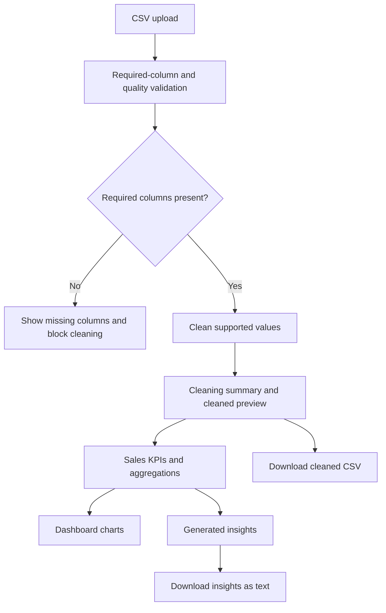

# Architecture and Workflow

## Overview

The application is a single-process Streamlit prototype. The front end accepts
a CSV upload and guides the user through validation, cleaning, dashboard
analysis, and generated insights. pandas DataFrames carry the uploaded and
cleaned data between steps in Streamlit session state. The application has no
database, external API, or persistent upload store.

## Main components

| Component | Responsibility |
| --- | --- |
| `frontend/streamlit_app_v2.py` | Streamlit layout, staged navigation, upload, session state, validation/cleaning orchestration, dashboard, and insight display. |
| `frontend/charts.py` | Altair charts with explicit chronological labels and date tooltips, rendered in Streamlit. |
| `backend/validation.py` | Required-column checks; missing-value, amount-format, invalid-date, duplicate, and currency-value checks. |
| `backend/cleaning.py` | Missing-value defaults, numeric amount conversion, date parsing, duplicate removal, and category normalization. |
| `backend/transformation.py` | KPI calculation, sales grouped by category/date, and category sales distribution. |
| `backend/insights.py` | Human-readable observations built from KPI and aggregation results. |
| `data/sales/` | Example and test CSVs for supported and intentionally invalid sales scenarios. |
| `tests/test_sales_trend.py` | Automated date, chart, fixture, and insight regression tests. |
| `tests/test_pipeline.py` | Print-based development smoke script for the sample data pipeline. |

## Data contract

The current workflow expects these exact column names:

| Column | Use |
| --- | --- |
| `date` | Parsed for daily, weekly, or monthly charts and insights. |
| `amount` | Converted to a numeric value for sales totals and aggregations. |
| `category` | Normalized for consistent category grouping. |
| `item` | Preserved as a sales record field and included in data cleaning. |

If a required column is absent, validation reports it and the app does not
allow the cleaning step to proceed. This is a sales-specific application; a
file with different business data is not automatically mapped to this schema.

## Cleaning and analytical behavior

- Missing values in the supported fields are filled with defaults defined by
  the cleaning module (empty strings for text/date fields and zero for amount).
- Dollar signs, commas, and surrounding whitespace are removed from amount
  strings before numeric conversion.
- Slash separators are replaced before date parsing. Use ISO-like dates such
  as `YYYY-MM-DD`; `DD-MM-YYYY` is also normalized as day-month-year.
  Unparseable dates become missing datetime values; the app does not infer or
  invent replacement dates.
- Exact duplicate rows are removed.
- Category text is stripped, case-folded for normalization, and displayed
  using title capitalization. Empty categories and repeated header rows are
  excluded from category analysis.
- Invalid or missing dates are retained in the cleaned data and contribute to
  sales totals, but they cannot contribute to date-based charts or insights.
- Negative amounts reduce the sales total; they may represent refunds or
  returns. The application does not infer why a value is negative.
- When the sales total is zero, category shares are set to zero and the
  application explains that percentage comparisons are unavailable.
- The sales trend adapts its aggregation to the valid date span: daily for
  spans up to 31 days, weekly for spans up to 180 days, and monthly for longer
  spans. Its title/caption and time-based insight use the same interval.
  All chart axes use ordered labels that identify their date period, with
  year-qualified labels to keep date ranges and year boundaries unambiguous.
  Monthly charts show every month; longer daily and weekly charts show a
  readable subset of labels while retaining all plotted data points.

These are current implementation rules, not configurable user policies.
