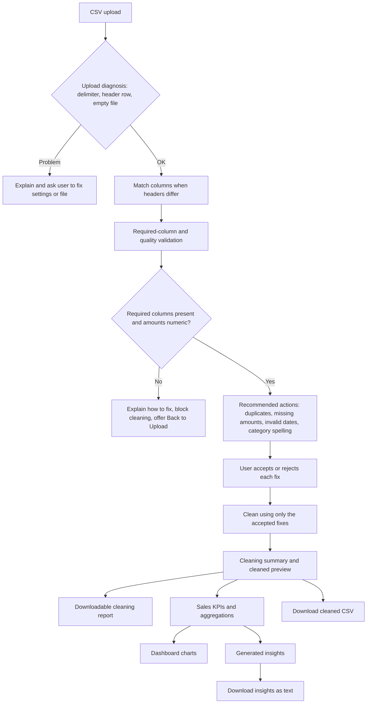

# Architecture and Workflow

## Overview

The application is a single-process Streamlit prototype. The front end accepts
a CSV upload and guides the user through validation, cleaning, dashboard
analysis, and generated insights. pandas DataFrames carry the uploaded and
cleaned data between steps in Streamlit session state. The application has no
database, external API, or persistent upload store.

## Main components

| Component | Responsibility |
| --- | --- |
| `frontend/streamlit_app_v2.py` | Streamlit layout, staged navigation, upload, session state, validation/cleaning orchestration, dashboard, and insight display. |
| `frontend/streamlit_app.py` | Original single-page Streamlit prototype retained as an alternate entry point. |
| `frontend/charts.py` | Altair charts with explicit chronological labels and date tooltips, rendered in Streamlit. |
| `backend/load_csv.py` | Low-level CSV parsing for a path or file-like input. Selects delimiter and header behavior; leaves sales-schema decisions to its caller. |
| `backend/csv_loader.py` | Sales-specific layer over `load_csv.py`; assigns required names for headerless sales files, rejects incompatible layouts, and turns empty/unreadable/ragged files into friendly errors. |
| `backend/upload_diagnosis.py` | Detects likely upload-setting mistakes (wrong delimiter, header-only file, first row that looks like data) and names the fix. |
| `backend/column_mapping.py` | Suggests and applies a mapping from a file's own headers (for example `Revenue`) to the required column names. |
| `backend/validation.py` | Required-column checks; per-column missing-value counts; amount/date validity masks; duplicate, missing-amount, and currency-format counts. |
| `backend/recommendations.py` | Builds the recommended actions (count, suggested fix, impact, preview, examples), suggests category spelling corrections, and cleans using only the fixes the user accepted. |
| `backend/cleaning.py` | Missing-value defaults, numeric amount conversion, date parsing, duplicate removal, and category normalization. |
| `backend/cleaning_report.py` | Formats the cleaning summary as the plain-text report offered for download. |
| `backend/transformation.py` | KPI calculation, sales grouped by category/date, and category sales distribution. |
| `backend/insights.py` | Human-readable observations built from KPI and aggregation results. |
| `data/sales/` | Example and test CSVs for supported and intentionally invalid sales scenarios. |
| `tests/` | Automated tests; see [testing.md](testing.md) for what each file covers. |

## Data contract

The current workflow expects these exact column names:

| Column | Use |
| --- | --- |
| `date` | Parsed for daily, weekly, or monthly charts and insights. |
| `amount` | Converted to a numeric value for sales totals and aggregations. |
| `category` | Normalized for consistent category grouping. |
| `item` | Preserved as a sales record field and included in data cleaning. |

If a required column is absent from a headered file, validation names the
missing column(s), blocks cleaning, and offers a route back to upload so the
user can correct and re-upload the CSV. This is a schema error, distinct from
an empty cell in an existing column: empty cells are counted by column and
filled during cleaning with the supported defaults. This is a sales-specific
application; a file with different business data is not automatically mapped
to this schema.

Non-empty amount values that cannot be converted to numbers block cleaning.
The validation screen identifies up to five example values with their
one-based CSV data-row numbers; the user must correct those values in the CSV.
Currency symbols and thousands separators are supported and removed during
cleaning. Missing or unparseable dates are also shown with example values and
data-row numbers, but do not block cleaning: their rows remain in totals and
are excluded from date-based charts and insights.

## Recommended actions (accept or reject before cleaning)

Validation never changes the data. For each issue found, the app shows a card
with the issue, a suggested fix, its impact, a preview of affected rows or
values, and a choice:

| Issue | Default choice | Alternative |
| --- | --- | --- |
| Duplicate rows | Remove them | Keep them |
| Missing amounts | Replace with 0 | Leave empty (ignored in totals and averages) |
| Invalid dates | Keep rows, exclude from trends | Remove the rows entirely |
| Likely misspelled category (for example `Electonics`) | Apply the correction | Keep the original value |

Category suggestions use `difflib.SequenceMatcher` with a 0.75 similarity
threshold, and only flag a label that is rarer than a very similar one, so
legitimate uncommon categories are normally left alone. Suggestions can still
be wrong, which is why each one is a choice. After the user applies the
choices, `clean_with_choices` returns the cleaned data and a summary, and
`build_cleaning_report` turns that summary into the downloadable report. The
original upload is never modified.

## Cleaning and analytical behavior

- Missing values in the supported fields are filled with defaults defined by
  the cleaning module (empty strings for text/date fields and zero for amount).
- Dollar signs, commas, and surrounding whitespace are removed from amount
  strings before numeric conversion.
- Slash separators are replaced before date parsing. Use ISO-like dates such
  as `YYYY-MM-DD`; `DD-MM-YYYY` is also normalized as day-month-year.
  Unparseable dates become missing datetime values; the app does not infer or
  invent replacement dates.
- Exact duplicate rows are removed.
- Category text is stripped, case-folded for normalization, and displayed
  using title capitalization. Empty categories and repeated header rows are
  excluded from category analysis.
- Invalid or missing dates are retained in the cleaned data and contribute to
  sales totals, but they cannot contribute to date-based charts or insights.
- Negative amounts reduce the sales total; they may represent refunds or
  returns. The application does not infer why a value is negative.
- When the sales total is zero, category shares are set to zero and the
  application explains that percentage comparisons are unavailable.
- The sales trend adapts its aggregation to the valid date span: daily for
  spans up to 31 days, weekly for spans up to 180 days, and monthly for longer
  spans. Its title/caption and time-based insight use the same interval.
  All chart axes use ordered labels with familiar month names and full years.
  Daily and weekly labels include an unpadded day; monthly labels show the
  abbreviated month and full year. Headings, tooltips, insights, and the
  cleaned-data preview use full month names for dates; the underlying cleaned
  data and downloaded CSV values are not reformatted for display.
  Monthly charts show every month; longer daily and weekly charts show a
  readable subset of labels while retaining all plotted data points.

These are current implementation rules, not configurable user policies.

## CSV header handling

The sales workflow accepts CSV files with or without a header row. With
headers enabled, the first row is interpreted as column names. When headers
are disabled, the loader assigns `date`, `amount`, `category`, and `item` in
that required order. Headerless files must have exactly four columns; files
with another column count are rejected with a user-facing error before they
reach validation. The message reports the number of columns read and required
order, and asks the user to check the delimiter. Since the file has no
headers, the app cannot identify which named field is absent. The
selected comma, tab, or semicolon delimiter applies in either mode. If the
header option is off but a header row is detected, the loader asks the user to
turn it on. If a headerless file is mistakenly read with headers enabled,
validation lists the missing required columns, suggests checking the header
option and delimiter, and directs the user back to upload. A headered file
read as one column gets a specific delimiter warning.

The two loader modules have deliberately separate responsibilities:
`backend/load_csv.py` performs the generic pandas read from a path or uploaded
file-like object and lets read/parse errors propagate. `backend/csv_loader.py`
calls that helper, then applies the sales-specific four-column contract and
raises `SalesCsvFormatError` for a user-correctable header/layout mismatch.
The Streamlit frontends call the sales-specific layer; the generic loader is
not a second competing upload workflow.

## Python source documentation

Python modules start with a module docstring describing their purpose.
Functions and test methods document their behavior, important inputs/outputs,
and non-obvious constraints. Inline comments are reserved for reasoning that
is not clear from the code itself; they are not repeated explanations of
straightforward statements.
